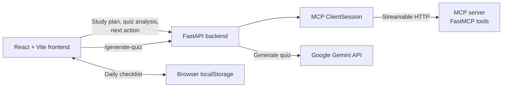

# LearnSphere AI

## 1. Project name

**LearnSphere AI** is a web-based learning coach with study-planning, quiz-analysis, progress, and AI-generated quiz tools.

## 2. Problem statement

Learners can struggle to turn a broad learning goal into manageable daily work, understand what quiz results mean, and decide what to study next. LearnSphere brings these activities together in one interface and provides actionable recommendations based on the information a learner enters.

## 3. Solution

LearnSphere provides a React frontend, a FastAPI backend, and an MCP server. The frontend sends learning requests to FastAPI. FastAPI uses the MCP server for study plans, quiz analysis, and next-step recommendations. AI quiz generation is a separate backend endpoint that calls the Google Gemini API.

## 4. Key features

- Create a study plan for a skill, level, and available daily study time.
- Analyze quiz results and receive a recommendation based on the score.
- Get a suggested next action based on recorded task progress.
- Track and reset a daily checklist; checklist state is saved in browser local storage.
- Generate multiple-choice quizzes by topic, difficulty, and question count.
- Submit answers and see the score, correct answers, and explanations.
- Browse a responsive dashboard and learning-tools interface.

## 5. Technologies used

| Area | Technologies |
| --- | --- |
| Frontend | React, Vite, JavaScript, CSS |
| Backend API | Python, FastAPI, Uvicorn, Pydantic |
| Tool server | MCP Python SDK (`mcp[cli]`) |
| AI quiz generation | Google Gemini API via `google-genai` |
| Configuration | `python-dotenv` for backend environment variables |

## 6. Architecture



The MCP server exposes `create_study_plan`, `analyze_quiz`, and `recommend_next_action`. AI quiz generation uses the separate FastAPI `/generate-quiz` endpoint and the model configured in `backend/quiz_generator.py`.

## 7. Installation instructions

### Prerequisites

- Python 3.13 (or a Python version supported by the installed dependencies)
- Node.js and npm
- A Google Gemini API key to generate AI quizzes

### Set up the backend

In PowerShell, from the project root:

```powershell
cd backend
py -3.13 -m venv venv
.\venv\Scripts\Activate.ps1
python -m pip install --upgrade pip
python -m pip install -r requirements.txt
```

Create `backend\.env` and add your Gemini API key:

```dotenv
GEMINI_API_KEY=your_gemini_api_key
```

Keep the real key private. The repository's `.gitignore` excludes `.env` files; do not commit your key.

### Set up the frontend

Open a second PowerShell terminal from the project root:

```powershell
cd frontend
npm install
```

Create `frontend\.env` with the FastAPI base URL used by the AI Quiz component:

```dotenv
VITE_API_URL=http://127.0.0.1:8000
```

Vite reads frontend environment variables when it starts. Restart the frontend development server after creating or changing this file.

## 8. How to run the frontend and backend

Start each service in a separate terminal. The backend and frontend need to be running for the complete application.

### FastAPI backend

In a terminal from the project root:

```powershell
cd backend
.\venv\Scripts\Activate.ps1
python -m uvicorn main:app --reload --host 127.0.0.1 --port 8000
```

The API is available at `http://127.0.0.1:8000`. Interactive API documentation is at `http://127.0.0.1:8000/docs`.

### Frontend

In a separate terminal from the project root:

```powershell
cd frontend
npm run dev
```

Open the Vite URL printed in the terminal (normally `http://localhost:5173`).

## 9. How to start the MCP server

The MCP server is a separate process. Start it in another terminal, from the project root:

```powershell
cd backend
.\venv\Scripts\Activate.ps1
python server.py
```

It listens on `http://127.0.0.1:8001` using Streamable HTTP. Start it before using the study-plan, quiz-analysis, or next-action features. The AI Quiz Generator calls Gemini through FastAPI and does not use the MCP server.

## 10. Screenshots of the application

Screenshots are not currently included in the repository. To add them, capture the running application and save the images under `docs\screenshots\`, then replace the descriptions below with Markdown image links.

Suggested screenshots:

- **Dashboard:** overall learning overview, progress, and checklist.
- **Learning tools:** study plan and quiz-analysis cards.
- **AI quiz:** quiz configuration or generated questions and results.

For example, after adding the image files:

```markdown


```

## Additional information

### Backend API endpoints

| Method | Endpoint | Purpose |
| --- | --- | --- |
| `GET` | `/` | Backend health check |
| `GET` | `/api/tools` | List MCP tools |
| `POST` | `/api/study-plan` | Create a study plan through MCP |
| `POST` | `/api/quiz-analysis` | Analyze quiz performance through MCP |
| `POST` | `/api/next-action` | Recommend a next step through MCP |
| `POST` | `/generate-quiz` | Generate an AI quiz through Gemini |

### Troubleshooting

- **AI quiz generation fails:** check the FastAPI terminal for the Gemini API error. Confirm `backend\.env` contains a valid `GEMINI_API_KEY`, and that the model configured in `backend/quiz_generator.py` is available to your account.
- **Quiz request cannot connect:** make sure FastAPI is running on port `8000` and `frontend\.env` sets `VITE_API_URL=http://127.0.0.1:8000`.
- **Study tools cannot reach MCP:** make sure `python server.py` is running on port `8001`.
- **Environment changes do not take effect:** restart the affected server after changing its `.env` file.
